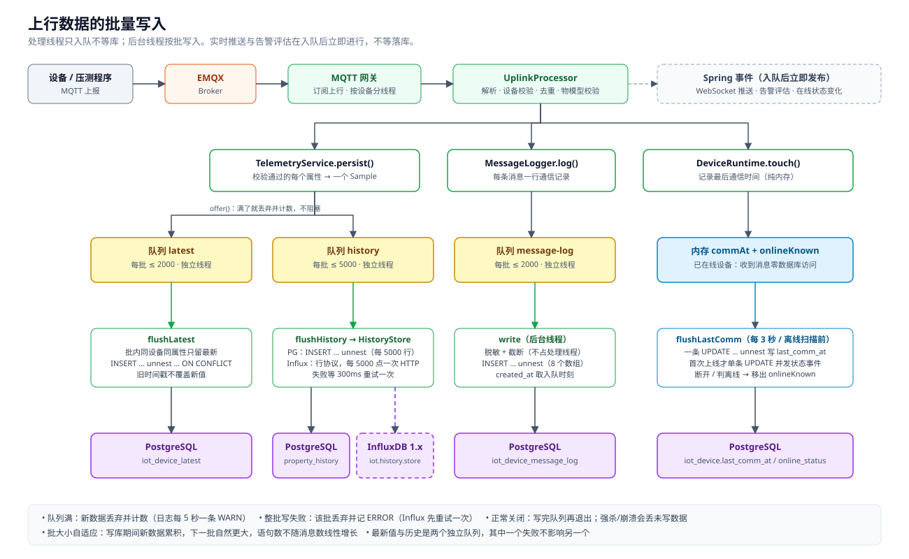
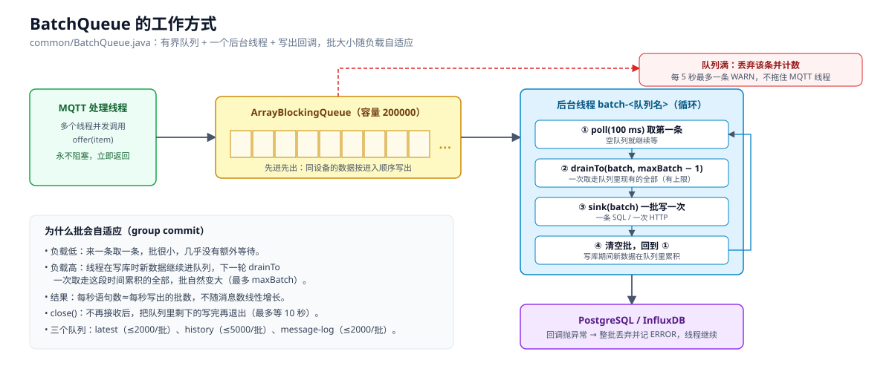

# 批量写入逻辑

上行消息（属性上报、通信记录、设备最后通信时间）不再逐条写库，而是先进内存队列，再由后台线程**成批**写入。本文说明每条数据怎么走、批是怎么攒的、各个存储怎么写、出错会怎样，以及怎么调。

> 状态：逻辑有单元测试和集成测试覆盖（`BatchQueueTest`、`DeviceRuntimeTouchTest`、`InfluxHistoryStoreTest`、`DeviceFlowIntegrationTest`）。**没有在真实高并发下压测过**，文中的数字都是推算，不是实测。

## 1. 总览



处理消息的线程（MQTT 处理线程）只做“放进队列”，不等数据库。Spring 事件（WebSocket 推送、告警评估）在入队之后立刻发布，**不等落库**。

## 2. 通用组件：BatchQueue

文件：`common/BatchQueue.java`。三个写入队列（`latest`、`history`、`message-log`）都用它。



**结构**：一个有界队列（`ArrayBlockingQueue`）+ 一个后台守护线程（名字 `batch-<队列名>`）+ 一个“写出回调”。

**后台线程循环**（`loop`）：
1. `poll(100ms)` 取一条；队列空就继续等。
2. 取到第一条后，`drainTo` 一次性再取走队列里现有的、最多 `maxBatch − 1` 条。
3. 把这一批交给回调写库，然后回到第 1 步。

**为什么批会自适应变大（group commit）**：线程在写库期间，新消息继续进队列；写完后下一轮 `drainTo` 会一次取走这期间累积的全部（最多 `maxBatch`）。负载越高，每批越大，**每秒的语句数不随消息数线性增长**；负载低时批很小，延迟也低（不会为了凑批而额外等待）。

**入队 `offer`**：永远不阻塞。队列满时丢弃这条、计数，并且最多每 5 秒打一条 WARN：`Batch queue 'x' is full: N items dropped so far`。这样即使数据库很慢，MQTT 线程也不会被拖住。

**写出失败**：回调抛异常时，整批丢弃（计入 dropped），打 ERROR：`Batch queue 'x' failed to write N items, they are lost`，线程继续工作，不会退出。

**关闭**：`close()` 把 `running` 置为 false，线程会把队列里剩下的全部写完再退出，`close()` 最多等 10 秒。正常关闭（Spring 的 `@PreDestroy`）不丢数据；被强杀或崩溃会丢队列里没写的数据。

## 3. 属性上报：最新值 + 历史

入口：`TelemetryService.ingestProperties` → 对每个属性按物模型校验（类型、范围、枚举）；通过的属性进入 `persist`：

```java
for (每个通过校验的属性) {
    Sample s = new Sample(deviceId, identifier, value, ts);
    latestWriter.offer(s);    // 写 PG 最新值
    historyWriter.offer(s);   // 写历史（PG 或 InfluxDB）
}
```

两个队列各有自己的线程，所以**历史存储慢（比如 InfluxDB）不会拖慢最新值，反过来也一样**。

### 3.1 最新值（PostgreSQL，`flushLatest` → `upsertLatest`）
1. **批内合并**：同一批里同一 `(device_id, identifier)` 只留时间戳最新的一条（`newest.merge`）。1 秒内同一属性报了多次，只写最后一次。
2. **一条语句写入**（每 5000 行一块）：
   ```sql
   INSERT INTO iot_device_latest (device_id, identifier, value, reported_at)
   SELECT d, i, v::jsonb, t FROM unnest(?::bigint[], ?::varchar[], ?::text[], ?::timestamptz[]) AS x(d, i, v, t)
   ON CONFLICT (device_id, identifier) DO UPDATE SET value = EXCLUDED.value, reported_at = EXCLUDED.reported_at
   WHERE iot_device_latest.reported_at <= EXCLUDED.reported_at
   ```
   - 参数是 4 个数组，不管多少行都是 1 条语句、1 次往返。
   - 批内已去重，所以不会触发 “ON CONFLICT 不能两次影响同一行”。
   - `WHERE reported_at <= EXCLUDED.reported_at`：迟到的（乱序的）旧数据不会覆盖新值。

### 3.2 历史 — PostgreSQL（`PostgresHistoryStore.writeBatch`）
每 5000 行一块，一条 `INSERT … SELECT … FROM unnest(5 个数组)` 写入 `iot_device_property_history`。`num_value` 是数值投影（布尔存 0/1，字符串等为空），用于聚合。历史**不去重**，每个样本一行。

### 3.3 历史 — InfluxDB（`InfluxHistoryStore.writeBatch`）
- 每个样本拼成一行**行协议**，毫秒精度：
  ```
  device_property,device_id=1,identifier=temperature num=23.5,json="23.5" 1700000000000
  ```
  - tag：`device_id`、`identifier`；字段：`num`（浮点，仅数值/布尔）、`json`（原值的 JSON 文本，其中的 `\` 和 `"` 会转义）。
  - 标识符不符合 `^[a-zA-Z][a-zA-Z0-9_]{0,63}$` 的样本会被跳过，防止构造出恶意行协议。
- 每攒够 **5000 行**（常量 `LINES_PER_REQUEST`）就 `POST /write?db=<库>&precision=ms[&rp=<保留策略>]` 一次；有用户名则带 Basic 认证。返回 204 视为成功，其他状态抛异常。
- **重试**：`TelemetryService.flushHistory` 在写失败时等 300 ms，**重试一次**；再失败这一批就丢弃（`BatchQueue` 记日志）。
- 过期清理交给 InfluxDB 的保留策略（`iot.influxdb.retention-days` 在启动时可自动创建）；后端的每日清理对 Influx 不做事。
- 一批进入 Influx 的上限由 `historyMaxBatch`（默认 5000）决定，即一次 `flushHistory` 最多 5000 个点，所以通常是**一次 HTTP 请求**；超过 5000 行时才会拆成多次。

## 4. 通信记录（`MessageLogger` → 队列 `message-log`）
- 每条上行/下行消息调用 `log(...)`，只做一件事：把一行放进队列（载荷先截断到 4000 字符，**脱敏和再截断放到后台线程做**，不占用处理线程）。
- 后台一批一条 `INSERT … SELECT … FROM unnest(8 个数组)` 写入 `iot_device_message_log`，每 5000 行一块；字段长度：topic、message 255，payload 2000。
- `created_at` 取**入队时刻**，不是写库时刻，所以延迟不会让时间变晚。
- 开关 `IOT_LOG_OK_PROPERTY=false`：不记录“成功的属性上报”（方向 UP、类型 PROPERTY、结果 OK），其余（失败、事件、状态、指令、下行）仍记录。注意仪表盘的“上报趋势 / 今日消息数 / 活跃设备”就是统计这些记录，关闭后三项会偏低。

## 5. 设备最后通信时间与在线状态（`DeviceRuntime`）
这块不用 `BatchQueue`，用“内存记录 + 定时批量刷新”：

- **每条消息**调用 `touch(ref)`：
  1. `commAt[deviceId] = 当前时间`（内存）。
  2. 如果该设备已在内存的 `onlineKnown` 集合里 → **直接返回，不访问数据库**（绝大多数消息走这条路径）。
  3. 否则（设备刚上线、或刚被判离线后又来消息）→ 同步执行一条 `UPDATE … WHERE online_status <> 'ONLINE' RETURNING id`，把状态置为 ONLINE，加入 `onlineKnown`；如果确实发生了状态变化，发布 `DeviceStatusEvent`（WebSocket 推送、离线告警恢复）。
- **`flushLastComm`**（`@Scheduled(fixedDelay = 3000)`，也在每次离线扫描前先调用一次）：复制 `commAt` 快照，用一条 `UPDATE iot_device … FROM unnest(ids, times) WHERE last_comm_at < 新值` 批量写 `last_comm_at`（每 5000 个设备一块），成功后只移除“值没有变化”的条目（写的过程中又来了新消息的条目保留到下次）。失败只记 WARN，下次再试。
- **离线判定**：`sweepOffline` 每 15 秒运行：先 `flushLastComm`，再把“在线且 `last_comm_at` 早于超时时间（`device.offline.timeout.seconds`，默认 90 秒）”的设备置为 OFFLINE，并从 `onlineKnown` 移除。
- `markDisconnected`（连接断开 / 遗嘱 / 禁用设备）同样把设备从 `onlineKnown` 和 `commAt` 移除，之后第一条消息会重新走第 3 步。
- 启动预加载设备认证缓存时，也会把库里已是 ONLINE 的设备装入 `onlineKnown`，避免重启后每个设备都多做一次 UPDATE。

## 6. 行为与语义（请知悉）
| 项 | 说明 |
|---|---|
| 落库延迟 | 通常百毫秒级；写库变慢时等于队列积压量 ÷ 写入速度。实时推送和告警评估不受影响。 |
| 页面立刻查 | 刚上报就查历史/最新值，可能还没落库，稍后刷新即可。 |
| 进程崩溃 | 队列里未写出的数据丢失；正常关闭会写完。 |
| 写失败 | PG 写失败：那一批丢弃并 ERROR 日志。Influx 写失败：重试一次，仍失败则丢弃。 |
| 最新值与历史可能不一致 | 两个队列独立，其中一个失败时，另一个的数据仍会写入。 |
| 同设备顺序 | 队列是 FIFO，同一设备的消息按进入顺序写；最新值另有时间戳保护。 |
| 去重 | 消息 `id` 去重发生在入队之前（`UplinkProcessor`），与批量写无关。 |
| `last_comm_at` | 最多滞后约 3 秒；离线判定前会先刷新，所以不会因此误判离线。 |
| 队列满 | 新数据被丢弃并计数；说明数据库/Influx 持续跟不上，需要加速写入或降低负载。 |

## 7. 配置
| 环境变量 | 默认 | 作用 |
|---|---|---|
| `IOT_BATCH_QUEUE` | 200000 | `latest`、`history`、`message-log` 每个队列的容量（条）。占用内存与容量成正比（每条几百字节量级，未实测）。 |
| `IOT_BATCH_MAX` | 2000 | `latest`、`message-log` 每批最多条数 |
| `IOT_BATCH_HISTORY_MAX` | 5000 | `history` 每批最多条数（Influx 官方建议每次 5000～10000 点） |
| `IOT_LOG_OK_PROPERTY` | false | 是否记录成功的属性上报（默认关：这条表是全量明细，10k msg/s 时约 13 GB/小时，见 `docs/perf-ingest-retro.md` §7） |
| `iot.history.store` | postgres | 历史存储：`postgres` 或 `influxdb` |
| `iot.influxdb.*` | 见 `docs/local-infra.md` | 地址、库、认证、保留策略 |

固定常量（改要改代码）：每次 SQL/HTTP 的块大小 5000、空闲轮询 100 ms、`last_comm_at` 刷新间隔 3 秒、Influx 重试 1 次间隔 300 ms、关闭等待 10 秒。

## 8. 吞吐估算（算术，不是实测）
设 5000 台设备每秒各报 1 次、每次 7 个属性：
- 进入 `latest` 和 `history` 队列的样本 = 5000 × 7 = **35000 条/秒**；通信记录 5000 行/秒；`touch` 5000 次/秒（几乎都是纯内存操作）。
- 若每次写出恰好取满一批：`latest` 约 35000 ÷ 2000 ≈ 18 条语句/秒，`history` 约 35000 ÷ 5000 = 7 次写入/秒，`message-log` 约 5000 ÷ 2000 ≈ 3 条语句/秒，`last_comm_at` 约 0.33 条语句/秒。
- 相比之前“每条消息约 3 次写库 + 每设备周期性状态更新”（每秒上万条语句），语句数下降 2～3 个数量级。**真正能达到的速率取决于数据库/Influx 服务器和网络，需要压测。**
- 注意：批内合并只对 `latest` 生效；`history` 和通信记录是逐条保存，写入的**行数**并没有减少，减少的是**语句数和往返次数**。

## 9. 监控与排查
- 日志关键字：`Batch queue '…' is full`（丢数据，队列满）、`Batch queue '…' failed to write`（整批写失败）、`Writing latest values failed`、`Flushing device last-communication times failed`。
- 压测时后端日志请用 INFO，DEBUG 会打印每条 SQL。
- 代码里有 `TelemetryService.droppedWrites()`、`MessageLogger.dropped()`、`BatchQueue.pending()/written()/dropped()`，**目前没有通过接口或页面暴露**；需要的话可以加到数据总览页。
- 现象对照：
  - 页面数据明显滞后、数据库 CPU 高 → 队列在积压，看是否出现 “is full”。
  - 出现 “failed to write” → 看紧跟的异常（连接断开、超时、SQL 错误）。
  - 历史曲线空但最新值有 → `history` 队列写失败（Influx 地址/库/认证问题）。

## 10. 代码位置
| 内容 | 文件 |
|---|---|
| 批处理队列 | `common/BatchQueue.java` |
| 入队、最新值 upsert、历史重试 | `telemetry/TelemetryService.java`（`persist`、`flushLatest`、`flushHistory`、`upsertLatest`） |
| PG 历史批量写 | `telemetry/PostgresHistoryStore.java`（`writeBatch`） |
| Influx 批量写 | `telemetry/InfluxHistoryStore.java`（`writeBatch`、`post`） |
| 通信记录批量写 | `telemetry/MessageLogger.java` |
| 最后通信时间 / 在线状态 | `device/DeviceRuntime.java`（`touch`、`flushLastComm`、`sweepOffline`） |
| 配置 | `config/IotProperties.java`（`Ingest.Batch`）、`application.yml` |
