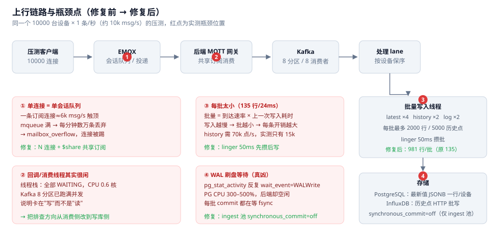
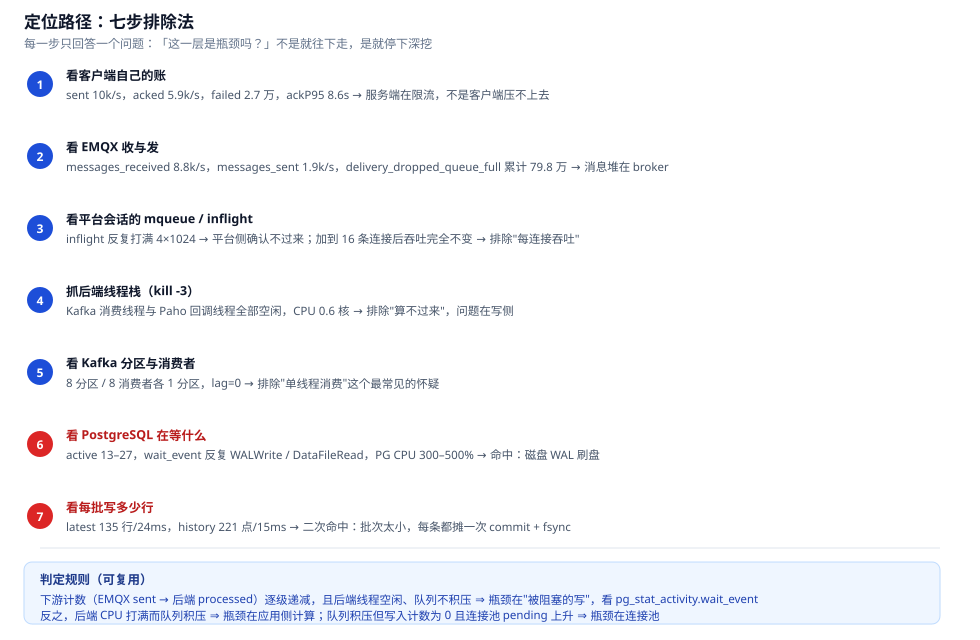
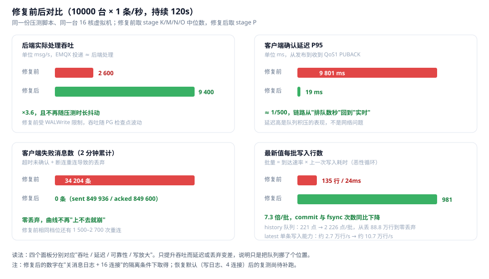

# 单机 1 万台设备上行的吞吐优化：一次完整的定位与复盘

> 场景：单机 OmniHub（16 核 / 11G 虚拟机），10 000 台设备每台每秒上报 1 条属性消息（每条 7 个属性，约 10k msg/s、70k 属性点/s）。
> 分支：`perf/throughput-bottlenecks`。四个修复，三笔提交。

> **这是一份历史记录，不是当前配置说明。** 文中"当时的默认值"（4 连接、1024 窗口、消息日志开）已经被后续实验改掉；
> 当前的默认值、容量公式和配置项见 [configuration.md](configuration.md) 与 [ingest.md](ingest.md)。

## 环境与前置条件

复现或对比本文数字之前，请先对齐下面这些条件，它们会直接改变结果。

| 项 | 取值 | 说明 |
|---|---|---|
| 被测机 | VMware Workstation 虚拟机，16 vCPU / 11.3 GB，Ubuntu 24.04 | 与压测机（Windows，28 个逻辑处理器）在**同一台物理机**上，互相抢 CPU |
| VM 网卡 | **vmxnet3**（2026-10-28 16:13 起） | 之前是 VMware 模拟的 AMD PCnet32（`pcnet32` 驱动，系统里显示 10 Mb/s 半双工）。换网卡前观察到：每轮接收错包约 1.1%、握手超时、连接上沉默约 20 秒，宿主机上 `vmware-vmx` 进程占约 13 个核。本文所有数字都是换成 vmxnet3 **之后**测的（首笔提交在 10-28 16:56），**没有在旧网卡上做过对照** |
| 分支基线 | `1a26c11`（10-28 15:57） | 已经包含：批队列分片写入（`ShardedBatchQueue`）、PostgreSQL 启动参数调优（`shared_buffers` 2GB、`max_wal_size` 8GB、`wal_compression`、更勤的自动清理）、EMQX 限制放宽、后端回调长连接修复。"修复前"指这一基线，而不是最初的出厂配置 |
| EMQX 限制 | `max_inflight` 1024（§8 调到 4096）、`max_mqueue_len` 10 万、`max_mailbox_size` 10 万 | 这是本项目 `docker-compose.yml` 的设置，**不是** EMQX 出厂默认（出厂是 32 / 1000 / 1000） |
| PostgreSQL | 14；`max_connections` 200；主池 40（`IOT_DB_POOL`）、ingest 池 12（`IOT_INGEST_DB_POOL`） | 全局 `synchronous_commit` 仍是 on，§3.4 的 off 只作用于 ingest 池 |

关于宿主机与 VM 抢 CPU，本文依据的是"VM steal = 0、宿主机 55–80%"（§5 第 8 条）；网卡的影响则无法从本文数据中分离。



## 0. 结论

| 指标 | 修复前 | 修复后<br>（关日志 + 16 连接） | 修复后<br>（当时默认：写日志 + 4 连接） |
|---|---|---|---|
| 后端实际处理 | 约 2.6k msg/s（随检查点抖动） | 9.4k msg/s（跟得上 10k 档位） | **2.0k msg/s** |
| 客户端 ack P95 | 9.8 s | 19 ms | 10.1 s |
| 2 分钟内客户端失败 | 34 204 条，重连 1 500–2 700 次 | 0 条，0 次重连 | 39 990 条，重连 1 639 次 |
| EMQX 会话队列丢弃 | 累计 79.8 万条并持续增长 | 不再增长 | 不再增长（后端在写库处就限流了） |
| 后端批队列丢弃 | history 88.8 万行 | 0 | latest 43.7 万、history 29.3 万 |
| latest 单条写入能力 | 约 2.7 万行/s | 约 10.7 万行/s | 约 1.8 万行/s |

**三列必须一起看。** 只有"关消息日志 + 多连接"这一组跑到 8–9.4k/s；当时的出厂默认（写消息日志、4 条连接）仍只有 2.0k/s 且会丢数据——默认配置的瓶颈已经不是本文修的四个点，而是"每条成功上报都往 PostgreSQL 写一行日志"本身，见 §7。关日志后 8 条与 16 条连接等价（都跑满、零失败），说明 8 条已经够用。

四个瓶颈依次暴露，修掉前一个才会看到后一个——这也解释了为什么"只改一处"的压测结论经常是错的。

**后续（§8）**：把上行会话从 8 条扩到 16 条、每会话在途窗口从 1024 提到 4096 之后，同一套系统在 5000 台 × 3 条/秒
（15k msg/s）下做到了 broker 零丢弃、后端全量处理；新的上限换成了 InfluxDB 的 history 写入（89k 点/s，而需要 105k）。

## 1. 现象：先分清三种"慢"

压测中最容易混淆的三件事，必须用不同指标区分：

1. **客户端发不出去**：`sent` 上不去，但 `acked ≈ sent`，失败少 → 客户端或网络。
2. **broker 收得下、投不出**：`messages_received` 远大于 `messages_sent`，`delivery_dropped_queue_full` 增长 → 消费侧慢。
3. **后端收得下、写不进**：`iot_ingest_processed_total` 停顿，批队列 `pending` 上升 → 写库慢。

本次是 2 和 3 交替出现，所以只看后端指标会漏掉 broker 侧的证据。

## 2. 定位：七步排除法



每一层的具体动作（都可复制）：

```bash
# ① 客户端：sent / acked / failed / ackP95 —— 由压测脚本自报
# ② broker 收与发
curl -s http://localhost:18083/api/v5/prometheus/stats | grep -E '^emqx_(messages_received|messages_sent|delivery_dropped_queue_full) '
# ③ 平台会话的队列与在途
curl -s 'http://localhost:18083/api/v5/clients?username=platform' -H "Authorization: Bearer $T" | grep -o '"mqueue_len":[0-9]*'
# ④ 后端线程栈（空闲也是证据）
docker exec omnihub-backend-1 kill -3 1 && docker compose logs --since 2m backend | awk '/Full thread dump/{f=1} f'
# ⑤ Kafka 分区与消费分配
curl -s localhost:8080/actuator/prometheus | grep kafka_consumer_coordinator_assigned_partitions
# ⑥ PostgreSQL 在等什么（本次的关键一步）
docker compose exec -T postgres psql -U iot -d iot -c \
  "select coalesce(wait_event,'-') w, count(*) from pg_stat_activity where backend_type='client backend' group by 1 order by 2 desc"
# ⑦ 每批写多少行、写多久
curl -s localhost:8080/actuator/prometheus | grep -E '^iot_batch_(size_sum|flush_seconds_sum|flush_seconds_count)'
```

**最重要的一次判断**：第 ④ 步发现 Kafka 消费线程和 MQTT 回调线程**全部空闲**、CPU 只有 0.6 核，而第 ⑥ 步显示 PG 有 13–27 个活跃连接、等待事件反复是 `WALWrite`。
"应用很闲 + 数据库在等磁盘" = 瓶颈不在应用代码，而在每次提交都要等 WAL 落盘这一事实。

在此之前还有一次**同样有价值**的排除：把上行连接从 4 条加到 16 条，吞吐**一点没变**。
如果只看"连接越多越快"的直觉，会在这上面浪费很久；反过来，这个"没有变化"直接证明了不存在"每连接吞吐上限"。

## 3. 四个根因与修复

### 3.1 单连接 = 单会话队列（提交 `5f398d3`）

一条订阅连接就是一个 broker 会话：一个 mqueue（本项目 `docker-compose.yml` 里设为 10 万条，EMQX 出厂默认是 1000）+ 一个 Paho 回调线程。
约 6k msg/s 就把队列填满，日志每分钟数万条 `dropped_msg_due_to_mqueue_is_full`，随后 `mailbox_overflow` 直接踢掉平台连接。

修复：`IOT_MQTT_INGEST_CONNECTIONS` 条连接全部订阅同一个 `$share/ingest/...` 共享订阅；EMQX 分发策略 `hash_clientid` 保证同一设备固定落到同一连接（保序），下游 Kafka 仍用 `productKey.deviceKey` 做 key。broker 不支持 `$share` 时自动降级单连接并打 error，避免变成 N 份重复投递。

> 补充（后来才发现）：`hash_clientid` 在 EMQX 5.7+ 的配置路径是 `mqtt.shared_subscription_strategy`，容器变量必须写成 `EMQX_MQTT__SHARED_SUBSCRIPTION_STRATEGY`。最初写的 `EMQX_BROKER__SHARED_SUBSCRIPTION_STRATEGY` 是 5.6 及更早的位置，在 5.7 上被**静默忽略**，实际一直是 `round_robin`。`docker-compose.yml` 已修正，[ingest.md](ingest.md) §2 记了验证命令。

### 3.2 一条消息写 7 行最新值（提交 `8d2e8bb`）

`iot_device_latest` 原来是 `(device_id, identifier)` 一行，7 个属性就是 7 次 UPDATE。10k×1 需要 7 万行更新/秒，实测 PG 只能到约 2.2 万/秒。

修复：Flyway V3 改成 `device_id` 主键 + `values JSONB`（`{"temp": {"v": 21.5, "t": ...}}`），一条消息 1 行；UPSERT 时逐属性比较 `t`，迟到旧值不会覆盖新值；旧数据自动聚合迁移。

### 3.3 每批太小：批量 = 到达速率 × 写入耗时（提交 `6c74553`）

实测每个 writer 的批次只有 135 行、却要 24ms——单行 0.18ms，几乎全是固定开销（一次 INSERT 往返 + 一次 commit + 一次 fsync）。

更糟的是这是**正反馈**：写入越慢，两批之间到达的数据越少，批次就越小，单行成本就越高。

修复：`BatchQueue` 增加 `lingerMs`（默认 50ms）。第一批到达后继续收集最多 50ms 再写，批次大小变成"50ms × 速率"，与写入快慢解耦。效果：latest 135 → 981 行/批，history 221 → 2 226 点/批。对 InfluxDB 这类"一次 HTTP 请求写一批"的目标收益最大。

### 3.4 每批 commit 都在等 WAL 刷盘（提交 `6c74553`）

这是真正的总闸门。`pg_stat_activity` 的 `wait_event=WALWrite` 说明会话已提交、正在等 WAL fsync；此时 PG 的 CPU 打满 300–500%，应用侧线程却空闲。

修复：只给 ingestion 连接池设置 `SET synchronous_commit = off`（`iot.ingest.synchronous-commit`，白名单校验，默认 `off`）。

- 影响范围只有 ingest 池（批写、设备状态、告警评估），HTTP/API 请求仍走默认的完全同步。
- 代价要说清楚：**操作系统崩溃**时，最后几百毫秒的最新值/历史/消息日志可能丢失；数据库本身不会损坏（不会出现半写页）。历史数据主要落在 InfluxDB，不受影响。
- 想回到旧行为：`IOT_INGEST_SYNCHRONOUS_COMMIT=on`。

## 4. 结果



修复后同一档位（stage P）：客户端 `sent 849 936 / acked 849 600 / failed 0`，ackAvg 10ms、ackP95 19ms；
后端处理 9.4k msg/s，PG 等待事件从 `WALWrite` 变成普通 `ClientRead`，`delivery_dropped_queue_full` 在整个窗口内零增长，三个批队列 pending 全部回落到 0。

## 5. 可复用的经验

1. **先建"分层计数"，再读代码。** 客户端 → broker → 消费 → 队列 → 数据库，每层都有计数；哪个相邻两层之间出现"递减且下游不积压"，瓶颈就在那个交界处。只盯一个指标（比如后端 CPU）永远会走偏。
2. **线程空闲是强证据，不是"没问题"。** 消费线程 WAITING + 队列不涨 + 下游数据库繁忙 = 阻塞在 I/O。反过来 CPU 打满才是应用侧计算问题。
3. **PG 的 `wait_event` 要当一等指标。** `WALWrite` / `WALSync` = 等磁盘；`DataFileRead` = 缓存不够；`LWLock` 才是锁竞争。只看 `pg_active` 数量会误判成"CPU 不够"。
4. **"批量写入"必须把批次大小做成指标。** 只写吞吐不写 batch size，就看不到 3.3 那个正反馈。经验值：批次小于 200 行时，固定开销通常已经占主导。
5. **并行度要"验证生效"，不要"配置了就相信"。** 16 条连接吞吐不变，这个否定结论比任何肯定结论都省时间。
6. **单变量优先用开关，不要重编镜像。** 改 `.env` + 重启单个容器（40 秒）比重新构建部署（几分钟）快一个数量级，也更不容易引入变量。
7. **注意计数器生命周期。** 后端重启后 `iot_ingest_processed_total` 从 0 开始，而 EMQX 的计数器跨重启保留；比较必须取同一时间窗口的差值，否则会得出荒谬的结论（本文所有速率都是差值计算）。
8. **压测机与被测机同物理机时，宿主机 CPU 会互相抢。** 16 核 VM 上"宿主机 55–80%、VM steal=0"才说明瓶颈在被测系统内部而不是资源争抢。

## 6. 遗留与注意

- 默认配置（写消息日志、4 条连接）的复测结果见 §7：只有 2.0k msg/s 且会丢数据。9.4k/s 只在"关日志 + 16 连接"下成立，不要当成默认配置的承诺值。
- `history` 写入 InfluxDB 的单点能力约 16 万点/s（2 个 writer，每批 2 226 点 / 27.9ms），高于当前 70k 点/s 的需求，但余量不大；再翻倍设备量要加 writer 或换批量协议。
- `synchronous_commit=off` 的取舍按业务定：如果消息日志要当审计证据，建议只对 latest/history 关闭，把消息日志留在独立池上同步提交。
- 压测脚本、开关脚本和采样器在 `scripts/` 与部署机上，属于一次性工具；[ingest.md](ingest.md) 和本文保留了逐轮变更记录。

## 7. 默认配置复测：瓶颈换成了消息日志

把 VM 的 `.env` 恢复成**当时的**出厂默认（`IOT_LOG_OK_PROPERTY=true`、`IOT_MQTT_INGEST_CONNECTIONS=4`）后重启后端，用完全相同的 10k×1、120s 脚本再跑一次（stage Q）：

```
sent=834 540  acked=753 923  failed=39 990
ackAvg=5 220ms  ackP95=10 110ms  reconnects=1 639  connFail=340
后端处理 242 928 条 / 120s ≈ 2.0k msg/s
```

比修复前的 2.6k 还低一点，但**回退的正是默认配置**——说明前四个修复并没有失效，只是被一个新的上限截住了。

### 7.1 证据：每个批量写入线程实际能写多少

| 队列 | 每批行数 | 每次写入耗时 | 单写入能力 | 合计 | 需求 |
|---|---|---|---|---|---|
| message-log | 166.8 | **79.75 ms** | 2.1k 行/s | 4.2k/s（2 线程） | **10k/s** |
| latest | 549.8 | 125.43 ms | 4.4k 行/s | 17.5k/s（4 线程） | 70k/s（已被采样压到～14k） |
| history | 1 105.6 | 58.49 ms | 18.9k 点/s | 37.8k/s（2 线程） | 70k/s |

对比 stage P（同一套代码、仅把日志关掉）：latest 每批 36.55 ms、history 每批 27.90 ms。**同一份 SQL，耗时翻 2–3 倍**，说明三条队列并不是各自独立的，它们在抢同一个磁盘和同一份 buffer cache。

同期 `pg_stat_activity` 的等待事件从 `ClientRead` 变成 `DataFileRead`（300–500 次/采样窗口），即 PostgreSQL 已经在从磁盘读页面了——shared_buffers 被 6 GB 的日志表挤出去了。

### 7.2 为什么这条表天生快不了

```
iot_device_message_log: 16 340 297 行 / 6 192 MB
  pkey                   351 MB
  idx_msglog_device_time 842 MB   （device_id, created_at DESC；随机插入）
  idx_msglog_time        367 MB   （created_at）
```

每插一行 = 1 次堆写 + 3 次索引写（其中 `device_id` 索引是跨设备的随机叶页更新），外加最多 2000 字符的 payload 进 WAL。

按实测 4.2k 行/s 的形态算账，这条表**即使不压测**也是不可持续的：

- 10k msg/s × 每条约 370 字节（行+索引）≈ 3.7 MB/s ≈ **13 GB/小时**，一天 300 GB；
- 本次测试 3 小时多就攒到 6.2 GB / 1634 万行，而 `idx_scan` 只有 934 / 639 次——**写得多、读得极少**。

所以"调参让它跑到 10k"没有意义：即使索引再优化一倍，也只能到 8k，而磁盘增长仍然是个位数小时就爆。

### 7.3 结论与建议（按代价从低到高）

1. **默认关掉"每条成功上报都写日志"**（`IOT_LOG_OK_PROPERTY=false`，**仓库默认值已经改为 false**）。代价：看板的"今日消息数"与趋势会少算——这已经是现有开关的已知行为，`.env.example` 里有说明。仅此一项，stage P 就在 16 连接下跑满 9.4k/s；4 连接下的组合本轮没测（见下表）。
2. **保留日志但按设备采样**：每个设备每 N 秒最多留一条（和 §3.3 的 latest 采样同一个思路），10k 设备 / 30s = 333 行/s，写入量可以忽略，趋势仍然有形状（但是"抽样趋势"）。
3. **改表形态**：`created_at` 索引换 BRIN（追加写 + 范围查询，体积约为 B-tree 的 1/100）、payload 另存、表按天分区或改 `UNLOGGED`。这能把上限从 4.2k 拉到 8k 量级，仍然不够 10k × 1 条/秒。
4. **根本解**：消息明细不进 PostgreSQL——写 Kafka / InfluxDB / 对象存储，PG 只保留"每设备每分钟计数"这类聚合行（10k 设备 = 167 行/s）。

### 7.4 本轮配置矩阵（未测项已标出）

| 消息日志 | 上行连接 | 后端处理 | ackP95 | 客户端失败 | 状态 |
|---|---|---|---|---|---|
| 关 | 16 | 9.4k/s | 19 ms | 0 | 已测（stage P） |
| 关 | 8 | 8.0k/s | 17 ms | 0 | 已测（stage R） |
| 开 | 4 | 2.0k/s | 10.1 s | 39 990 | 已测（stage Q，默认配置） |
| 关 | 4 | — | — | — | 未测（复测被中断） |
| 开 | 16 | — | — | — | 未测 |

stage R（关日志 + 8 连接，120s）明细：`sent 850 162 / acked 850 097 / failed 0`，ackAvg 8ms、ackP95 17ms，重连 0 次、丢失 0 条；
后端处理 960 163 条 ≈ 8.0k msg/s，三个批队列 **丢弃全 0、积压全 0**，PG 等待事件只有 `ClientRead`，
`delivery_dropped_queue_full` 在整个窗口内没有增长。

**8 连接和 16 连接等价**：两档的客户端发送量（849 936 / 850 162）、失败数（0 / 0）、ackP95（19 / 17ms）
在噪声范围内相同。也就是说这一档的 10k msg/s 是**客户端自己的节奏**（连接逐个建立，平均 7.1k/s），
平台侧还有余量，不是被 8 条连接卡住的。剩下的唯一未知量是"关日志 + 4 连接"是否也够用。

各队列余量（stage R，全部零丢弃）：

| 队列 | 每批行数 | 每次写入 | 单写入能力 × 线程 | 需求 |
|---|---|---|---|---|
| latest | 956.2 | 33.55 ms | 28.5k × 4 = 114k 行/s | 约 70k 属性/s |
| history | 2 104.1 | 24.18 ms | 87k × 2 = 174k 点/s | 约 70k 点/s |
| message-log | 10.1 | 2.03 ms | 几乎空转（只记非 OK 与非属性消息） | — |

已知的两个格子不能直接外推：stage P 与 stage Q 同时改了两个变量（日志开关、连接数），"关日志 + 4 连接"这一档是判断"4 条连接是否够用"的关键，但它在本次中断了，**不要用插值代替测量**。

补充：stage R（关日志 + 8 连接）已经测过，与 16 连接等价（客户端发送量、失败数、ackP95 在噪声内相同）。所以"上调连接数"的收益在 8 条就吃满了；4 条是否够用仍未测。

### 7.5 复测本身的局限

- 单次 120s、未做多轮取中位数；`failed` 里混有"客户端主动重连"与"真超时"，只有配合 `connFail`/`lost` 才能分开看。
- 采样器 3–8s 一个点，且指标计数器在后端重启后归零；本节的速率全部用同一窗口的差值计算。
- 压测机与被测 VM 在同一台物理机上（宿主 CPU 峰值 55–80%），本轮没有做"仅压测机空闲"的对照，宿主机争抢对 2.0k 与 9.4k 两组数字的影响方向相同，但不排除绝对值有偏差。

## 8. 第二个上限：broker → 后端的投递窗口

关掉消息日志之后，8 连接把 10k 档位跑通了（stage R），于是接着往上加压力。这一节记录 12k / 15k 两档暴露出来的
**新瓶颈**，以及"扩会话 + 放大在途窗口"之后的 15k 结果。

### 8.1 现象：窗口顶死，队列堆积，下游全闲

同样是 10 000 台设备，只把每台速率从 1.0 提到 1.2 / 1.5（即 12k / 15k msg/s）：

| 档位 | EMQX 收到 | 后端处理 | 平台会话 inflight | 单会话 mqueue 峰值 | 客户端失败 |
|---|---|---|---|---|---|
| 10k（8 连接，stage R） | 8.5k/s | 8.0k/s | 未顶满 | 约 6k | **0** |
| 12k（stage S） | 8.5k→12k/s | **8.8k/s** | 7 214 / 8 192 | 28 210 | 17 026 |
| 15k（stage T） | 11.5k/s | **4.6k/s** | **8 192 / 8 192** | **67 194**（合计 40.3 万） | 90 305（connFail 16 267） |

`inflight` 精确停在 `8192 = 8 × 1024`——1024 是本项目 `docker-compose.yml` 里 `EMQX_MAX_INFLIGHT` 的取值（EMQX 出厂默认是 32），8 条连接就是 8 个会话。注意它停在 1024 而不是 8 × 1000：当时 Paho 侧硬编码的 `setMaxInflight(1000)` 并没有参与限制，见 §8.3 的更正。
这是"窗口满 + 队列积压"的典型形态：broker 每会话只能有 1024 条未确认消息，确认得不够快，后面的就进 mqueue 排队，
再满就丢。

### 8.2 证据：这次不在应用里

四项互相独立的证据都指向同一段链路：

1. **数据面卡在投递窗口。** 8 个会话的 inflight 全部顶在 8192，同时 mqueue 从 0 一路涨到 40 万条。
2. **PostgreSQL 全程空闲。** `pg_active` 只有 1–5，等待事件是 `ClientRead`（不是 `WALWrite`、不是 `DataFileRead`）；
   三个批队列 `pending = 0`、`drops = 0`。前四个修复没有回退。
3. **Kafka 没有阻塞。** `buffer_exhausted_total = 0`、`buffer_available = buffer_total = 32 MB`、`waiting_threads = 0`、
   `record_error_total = 0`。这条很关键：`messageArrived` 是在 Paho 回调线程里**同步**调用 `forward()` 的，
   如果 Kafka 顶住了，表现出来也会是 inflight 满；Kafka 的指标证明它没有。
4. **EMQX 自己被调度饿着了。** 15k 档 EMQX 日志出现 **264 次 `long_schedule`，延迟 265–463 ms**，调用栈全部是
   `esockd_acceptor`（accept 路径：`async_accept` / `port_control` / `gen_server:call`）。同窗口客户端出现
   **16 267 次连接失败**、2 680 次重连，`peakConnected` 只有 9 686/10 000。broker 侧 `packets_connack_error` 只有
   1 943，说明不是策略拒连，而是**接不进来**。

所以这一档的吞吐公式是：

```
平台消费能力 ≈ 会话数 × 每会话在途窗口 ÷ 单条消息的确认往返
             = 8 × 1024 ÷ 约 1.8 s ≈ 4.6k/s      ← 与实测 4.7k/s 吻合
```

两个乘数都到顶了：窗口是配置死的（EMQX `max_inflight` 1024/会话），往返变长是因为 EMQX 的
accept/scheduler 被拖慢（264 次长调度）。**12k 其实也没过**：inflight 7 214/8 192、mqueue 2.8 万，说明 8 连接下
可持续上限约 8.8k msg/s，12k 和 15k 都在上限之上，区别只是 15k 多了一场连接风暴，把 broker 的 accept 路径也拖垮了，
从"欠账"退化成"塌方"。

### 8.3 修复：把在途窗口做成配置

提交 `43ea857`：

```yaml
iot:
  mqtt:
    ingest-connections: ${IOT_MQTT_INGEST_CONNECTIONS:16}
    max-inflight: ${IOT_MQTT_MAX_INFLIGHT:4096}   # 新增；原来是硬编码 1000（只影响平台向外发布的在途数，见下面的更正）
```

```java
opts.setMaxInflight(Math.max(1, cfg.getMaxInflight()));   // 原来是硬编码 1000；限制的是客户端自己发布的在途数
```

broker 侧用已有的 `EMQX_MAX_INFLIGHT`（→ `EMQX_MQTT__MAX_INFLIGHT`）。

> **更正（本节原文写的是"两者取小：只调大一边不会有效果"，经核对不成立）**
>
> 上行接收窗口**只由 broker 一侧决定**，即 `EMQX_MAX_INFLIGHT`。MQTT 3.1.1 没有接收窗口的协商；Paho 的
> `MqttConnectOptions.setMaxInflight` 只限制**客户端自己发布**的在途消息数（Paho 1.2.5 的默认值是 10，只在发送队列里
> 使用，对应平台下发的指令），不影响 broker 往这个客户端投递多少条。本文自己的数据就能反证：stage T 的 inflight
> 停在 8 192 = 8 × 1024，而当时 Paho 侧是 1000——如果"取小"成立，应当是 8 000。
>
> 所以 `IOT_MQTT_MAX_INFLIGHT` 对上行**没有作用**；§8.4 stage U 的改善来自 **16 个会话**和 **`EMQX_MAX_INFLIGHT=4096`**
> （总窗口 16 × 4096 = 65 536 由 EMQX 这一侧给出）。要调接收窗口，只需要改 EMQX 那个变量。

`.env.example`、`docker-compose.yml` 和 `application.yml` 的默认值已经统一成 16 / 4096 / 4096（也就是本节验证过的那一档），
所以全新部署不需要再手动调。

### 8.4 结果：16 会话 × 4096 窗口跑 15k

配置 `16 连接 / EMQX 4096`（总在途窗口 16 × 4096 = 65 536；Paho 侧的 4096 不参与，见 §8.3 更正），压测改为 **5 000 台 × 3 条/秒 = 15k msg/s**（stage U）：
少一半 MQTT 连接，同样的消息速率，避免客户端连接风暴干扰结论。

```
sent 1 458 466  acked 1 403 430  failed 36 584   peak sent 14 999/s  peak acked 15 356/s
ackAvg 603ms  ackP95 3 560ms  connFail 20  reconnects 584  lost 586   peakConnected 5 000/5 000
```

| 指标 | stage T（8×1024，10k 台×1.5） | stage U（16×4096，5k 台×3） |
|---|---|---|
| 峰值发送 | 14 445/s（但连接抖动） | **14 999/s** |
| 后端处理 | 4.6k/s | **14.5k/s** |
| 平台会话 inflight | 8 192 / 8 192（顶死） | 4 879 / 65 536（**没用满**） |
| 单会话 mqueue | 40.3 万 | **全程 0** |
| EMQX `long_schedule` | 264 次 | 59 次（无 congestion） |
| 客户端 connFail | 16 267 | **20** |

关键的一行：**后端处理 1 574 498 条 = EMQX `messages_sent` 1 574 498 条，broker 侧零丢弃**。
窗口放大后 mqueue 恒为 0、总在途只用到 4 879/65 536，说明 16×4096 对 15k 是**大幅过量**的（这也是安全的：
过度预留窗口不会降低吞吐，只会在下游卡住时攒出更大的突发）。

### 8.5 但 15k 并没有"全绿"：上限换成了 InfluxDB history

stage U 的三万多个客户端失败和 1.53M 条丢弃点，必须分开看：

| 队列 | 每批 | 每次写入 | 单写入能力 × 线程 | 需求 | 丢弃 |
|---|---|---|---|---|---|
| latest | 586.1 行 | 37.71 ms | 15.5k × 4 = 62k 行/s | 约 70k 属性/s | 0 |
| **history** | **4 396.1 点** | **98.32 ms** | **44.7k × 2 = 89k 点/s** | **约 105k 点/s** | **1 530 509** |
| message-log | 5.8 行 | 5.29 ms | 几乎空转（日志已关） | — | 0 |

latest 的数字看着"刚好不够"，但它有 `IOT_LATEST_MIN_INTERVAL_MS=1000` 的设备级采样，实际入库量低于 70k，
所以零丢弃——**余量很小**，再往上加设备量时它会第一个顶住。

15k msg/s × 7 属性 = 105k 点/s，而 2 个 history writer 只有 89k/s。每批 4 396 点已经很接近 InfluxDB 单次请求的
合理上限，所以缺的不是批大小，而是**并发写**。

对应的建议（改 `.env` 即可，不需要重建镜像）：

```
IOT_BATCH_HISTORY_WORKERS=4      # 2 -> 4，理论上限 89k -> 约 180k 点/s
```

代价是 InfluxDB 侧压力翻倍。分片数与线程数在这套实现里是同一个值（`ShardedBatchQueue` 的 shard 与 writer 线程一一对应，
metrics 里 history 的两个 shard 就是这两个 worker），所以只改这一个变量即可，不需要另外调 shard。

客户端侧的 36 584 次失败（2.5%）与 `ackP95 = 3 560 ms` 是同一件事的两面——它们是客户端在长尾延迟下打满
自己的发送节拍，不是后端欠账（后端一条没少收）。要把它压到 0，下一步应该看"ack 长尾为什么是 3.5 秒"，
而不是继续加窗口。

### 8.6 本轮配置的全部结论

| 配置 | 目标速率 | 结果 | 建议 |
|---|---|---|---|
| 8 连接 × 1024 | 10k | 通过，零失败 | 10k 以下够用（想省连接数就用这档） |
| 8 连接 × 1024 | ≥12k | 上限 8.8k，会丢 | **不要用** |
| **16 连接 × 4096** | 15k | broker 零丢弃、后端全量接收 | **已设为仓库默认值** |
| 16 连接 × 4096 | 15k + 2 个 history writer | history 丢 153 万点 | 需 `IOT_BATCH_HISTORY_WORKERS=4` |

配套改掉的默认值：`.env.example`（16 / 4096 / `EMQX_MAX_INFLIGHT=4096`）、`docker-compose.yml` 的
`:-` 兜底值、`application.yml` 与 `IotProperties` 的字段默认值，以及消息日志开关 `IOT_LOG_OK_PROPERTY`
（`true` → `false`，理由见 §7）。全新部署开箱就是本节验证过的这一档。

一条可以带走的经验：**"瓶颈在哪"要看相邻两层之间谁在积压。** 这次下游（PG、Kafka、批队列）全部干净，
唯一的积压出现在 broker 的会话队列里，那答案就只能是窗口与确认往返——继续优化数据库不会有任何收益。

### 8.7 复核：共享订阅策略真的生效了吗

§3.1 里"`hash_clientid` 保证同一设备固定落到同一条连接"这句，当时只是按 compose 里的变量名写的。后来核对
运行中的 broker 才发现**它一直没生效**：EMQX 5.7 把共享订阅的配置从 `broker.*` 挪到了 `mqtt.*`，而 compose 里
写的是 `EMQX_BROKER__SHARED_SUBSCRIPTION_STRATEGY`——不认识的键被静默忽略，实际一直是默认的 `round_robin`
（也就是"同一设备的消息可能被投到不同连接"，`AlarmEngine` 的连续 N 次计数会受顺序影响）。

```bash
docker compose exec emqx emqx ctl conf show mqtt | grep shared_subscription_strategy
# 修正前: round_robin        修正后: hash_clientid
```

键名改为 `EMQX_MQTT__SHARED_SUBSCRIPTION_STRATEGY` 之后生效（提交 `a977c7a`）。同一镜像的一次性容器验证了
这个构建接受的全部取值与非法值的表现：

```
random / round_robin / sticky / hash_topic / hash_clientid / local  -> 都能启动并生效
bogus_value                                                        -> 启动失败 (failed_to_check_schema)
```

另外记一条运维事实：**broker 重启后要 129 秒才回到 16/16 会话**（Paho 退避默认封顶 128 秒），
满载时这段窗口足以丢数据。原因、实测时间线和一行修复方案见 [operations.md](operations.md) §3.1——目前**未改**，只记档。
